# Manual de Arquitectura y Documentación Técnica Maestra: Sandbox Game
> **Propósito del Documento**: Este archivo constituye la **fuente de verdad definitiva y ancla técnico integral** para desarrolladores y modelos de inteligencia artificial (LLMs). Documenta de forma exhaustiva la arquitectura cuádruple del proyecto, el catálogo técnico completo de los **12 submódulos especializados**, el núcleo orquestador `sandbox_grid.gd`, los sistemas de simulación celular en C++, los shaders en GPU, y las guías prácticas para extender cualquier subsistema sin riesgo de regresiones.

---

## 1. Visión General del Proyecto

### 1.1 Naturaleza del Proyecto
**Sandbox Game** es un simulador de física de partículas y autómata celular interactivo ("falling-sand game") en 2D desarrollado para dispositivos móviles (Android/iOS) y PC sobre **Godot Engine (versión 4.x)**. Permite a los jugadores experimentar en tiempo real con cientos de miles de partículas de materiales elementales, fluidos, gases, circuitos lógicos integrados, mecanismos mecánicos (pistones, cañones, tuberías neumáticas), desastres naturales reactivos, instrumentos musicales afinados y personajes inteligentes (NPCs) dotados de máquinas de estados, emociones reactivas y control manual estilo arcade.

### 1.2 Arquitectura en 4 Capas (C++ + GDScript Core + Módulos + GPU Shaders)
Para conciliar la demanda computacional extrema de la simulación de partículas con la alta modularidad y mantenibilidad del código, el proyecto se estructura en **cuatro capas cooperativas**:

```mermaid
graph TD
    subgraph Capa 1: GPU Shaders
        S1[sandbox_render.gdshader: Renderizado 60 FPS + Fast-Path Aire]
        S2[tornado_visual.gdshader: Distorsión cinemática]
    end

    subgraph Capa 2: Motor C++ GDExtension
        CPP[SandboxGridNode: C++ Nativo por Chunks 16x16]
        CPP -->|process_physics: Pass 1 Gases + Pass 2 Interacciones y Gravedad| CPP
        CPP -->|process_electricity: Propagación BFS y ELECTRIC_ACTIVATED| CPP
        CPP -->|process_pistons: Empuje masivo sin CoW + arrastre de pintura| CPP
        CPP -->|map_grid_data: Mapeo directo ptrw de arrays y chunks| CPP
    end

    subgraph Capa 3: Orquestador Central GDScript
        Core[sandbox_grid.gd: SandboxGrid ~8.580 líneas]
        Core <-->|Punteros directos + Cola de Eventos| CPP
        Core <-->|palette_tex, charge_tex, element_paint_tex, background_tex| S1
        Core -->|Orquestación, eventos de explosión/SFX, NPCs y dibujo| Core
    end

    subgraph Capa 4: Subsistemas Modulares COLD
        M1[FontHelper: sandbox_font_helper.gd]
        M2[HistoryManager: sandbox_history.gd]
        M3[AchievementManager: sandbox_achievements.gd]
        M4[DialogManager: sandbox_dialogs.gd]
        M5[ToolsPaintUI: sandbox_tools_ui.gd]
        M6[SaveSystem: sandbox_save_system.gd]
        M7[WorkshopUI: sandbox_workshop_ui.gd]
        M8[LabUI: sandbox_lab.gd]
        M9[MusicSystem: sandbox_music.gd]
        M10[NpcControlManager: sandbox_npc_control.gd]
        M11[DisasterManager: sandbox_disasters.gd]
        M12[MechanismsManager: sandbox_mechanisms.gd]
    end

    Core <--> M1
    Core <--> M2
    Core <--> M3
    Core <--> M4
    Core <--> M5
    Core <--> M6
    Core <--> M7
    Core <--> M8
    Core <--> M9
    Core <--> M10
    Core <--> M11
    Core <--> M12
```



1. **Capa 1: GPU Shaders (`sandbox_render.gdshader`, `tornado_visual.gdshader`)**:
   - Transforma los arreglos crudos de enteros (material IDs, carga eléctrica, variantes y pintura adherida `element_color_tex`) en píxeles coloreados, iluminación dinámica de cables y texturas procedurales a 60 FPS sin cargar la CPU.
   - Incorpora un **Fast-Path para Aire (`id == 0`)** que retorna `texture(background_tex, UV)` inmediatamente (ahorrando >70% de lecturas de textura y ramas condicionales en GPUs móviles como Adreno 540) y agrupa los mecanismos detrás de `if (id >= 81)` y los efectos eléctricos detrás de `if (charge > 0.05)`.
2. **Capa 2: C++ GDExtension (`SandboxGridNode`)**:
   - Código fuente en `sandbox/gdextension/src/` (`sandbox_grid_node.cpp`, `sandbox_grid_node.h`), compilado con `-O3 -ffast-math -fno-finite-math-only` (MinGW-w64 en Windows y Clang NDK `27.2.12479018` en Android `arm64`/`arm32`).
   - Ejecuta en memoria nativa el 100% de la física celular e interacciones químicas/térmicas/eléctricas/biológicas en `process_physics` (Pass 1 para gases `GRAV_UP` y Pass 2 para reacciones y gravedad), saltando bloques de 16 píxeles en **chunks inactivos de $16 \times 16$ (`chunks_active`)**.
   - Devuelve a GDScript una cola compacta de eventos (`explosions`, `fireworks`, `acid_smoke`, `sparks`) y banderas de estado (`charge_changed`, `paint_changed`).
3. **Capa 3: Orquestador Central GDScript (`sandbox_grid.gd` ~8.580 líneas)**:
   - Hereda directamente de `SandboxGridNode`.
   - Orquesta la simulación por cuadro (`_step_simulation()` con detección automática de modo dual C++/GDScript), procesa los eventos de explosión/SFX devueltos por C++, gestiona la IA de NPCs, sube texturas a GPU bajo demanda (`_update_texture()`) y controla la cámara y el HUD.
4. **Capa 4: Subsistemas Modulares Especializados (`res://sandbox/scripts/sandbox/modules/`)**:
   - 12 clases autónomas que encapsulan la lógica de menús, persistencia, red, audio, desastres y mecanismos (*COLD / Event-Driven*), reduciendo el núcleo original de 21.844 a ~8.580 líneas.

### 1.3 Estructura del Árbol de Directorios
- `sandbox/`: Raíz del proyecto Godot.
  - `project.godot`: Archivo maestro de configuración, autoloads y plugins.
  - `gdextension/`: Fuentes C++ y scripts de compilación SCons (Windows x86_64, Android arm64/arm32).
  - `scenes/`:
    - `sandbox_main.tscn`: Escena jugable principal con la cuadrícula de simulación y el HUD.
    - `main/loading_screen.tscn`: Pantalla inicial de carga con verificación de versión.
    - `main/world_card.tscn`: Tarjeta UI de mundos comunitarios para el Workshop.
    - `npc_editor.tscn`: Editor de sprites y estados de NPCs personalizados.
  - `scripts/sandbox/`:
    - `sandbox_grid.gd`: **Orquestador central** del simulador.
    - `material.gd`: Recurso `SandboxMaterial` y definición canónica de `Tags`.
    - `sandbox_render.gdshader`: Shader de renderizado de la cuadrícula celular.
    - `tornado_visual.gdshader`: Shader de distorsión del vórtice de tornados.
    - `workshop_manager.gd`: Autoload gestor de APIs de Firebase (Firestore y Storage).
    - `world_card.gd`: Controlador de tarjetas de mundos (Likes, descargas, reportes).
    - **`modules/` (Los 12 Submódulos Especializados)**:
      - `sandbox_font_helper.gd`: `SandboxFontHelper` (Caché tipográfica universal y fallbacks de emojis).
      - `sandbox_history.gd`: `SandboxHistoryManager` (Historial circular de Undo/Redo y snapshots profundos).
      - `sandbox_achievements.gd`: `SandboxAchievementManager` (Motor de 22 logros, polling escalonado y UI modal).
      - `sandbox_dialogs.gd`: `SandboxDialogManager` (Tutorial guiado, popups de calificación y efectos visuales de pulso).
      - `sandbox_tools_ui.gd`: `SandboxToolsPaintUI` (Ajustes de herramientas, volumen, pausa y paleta de pintura).
      - `sandbox_save_system.gd`: `SandboxSaveSystem` (Serialización binaria `.sbu`, 10 slots locales y WebP).
      - `sandbox_workshop_ui.gd`: `SandboxWorkshopUI` (Taller en la nube, Top Semanal, buscador Base-36 y descargas).
      - `sandbox_lab.gd`: `SandboxLabUI` (Laboratorio de alquimia de 3 materiales custom IDs 900-902).
      - `sandbox_music.gd`: `SandboxMusicSystem` (Bus de audio con limitador, 5 instrumentos cromáticos y metrónomo).
      - `sandbox_npc_control.gd`: `SandboxNpcControlManager` (Mando virtual táctil arcade para posesión de NPCs).
      - `sandbox_disasters.gd`: `SandboxDisasterManager` (Simulación de tornado, tsunami, terremoto, bombardero y clima).
      - `sandbox_mechanisms.gd`: `SandboxMechanismsManager` (Compuertas lógicas, pistones, cañones, tuberías y LEDs).
  - `assets/`: Fuentes (`fonts/`), iconos de logros (`icon_ach/`), SFX (`audio/sfx/`).
  - `translations/`: Tablas de traducción CSV y recursos compilados (ES, EN, IT, FR, DE, PT).

---

## 2. Catálogo Técnico y Manual de los 12 Módulos Especializados

Cada módulo se instancia e inyecta en `sandbox_grid.gd` durante `_ready()`, recibiendo la referencia del orquestador mediante `setup(self)`. A continuación se detalla cada componente:

```
+---------------------------------------------------------------------------------------------------+
| RESUMEN DE LA ARQUITECTURA MODULAR                                                                |
+----+-----------------------------+-------------------------------+-------------------+------------+
| #  | Clase                       | Archivo en modules/           | Instancia en grid | Líneas     |
+----+-----------------------------+-------------------------------+-------------------+------------+
| 1  | SandboxFontHelper           | sandbox_font_helper.gd        | (Estática/Caché)  | ~42        |
| 2  | SandboxHistoryManager       | sandbox_history.gd            | history_manager   | ~212       |
| 3  | SandboxAchievementManager   | sandbox_achievements.gd       | achievement_mgr   | ~1.188     |
| 4  | SandboxDialogManager        | sandbox_dialogs.gd            | dialog_manager    | ~1.444     |
| 5  | SandboxToolsPaintUI         | sandbox_tools_ui.gd           | tools_ui          | ~1.176     |
| 6  | SandboxSaveSystem           | sandbox_save_system.gd        | save_system       | ~1.510     |
| 7  | SandboxWorkshopUI           | sandbox_workshop_ui.gd        | workshop_ui       | ~3.109     |
| 8  | SandboxLabUI                | sandbox_lab.gd                | lab_ui            | ~1.363     |
| 9  | SandboxMusicSystem          | sandbox_music.gd              | music_system      | ~1.148     |
| 10 | SandboxNpcControlManager    | sandbox_npc_control.gd        | npc_control_mgr   | ~808       |
| 11 | SandboxDisasterManager      | sandbox_disasters.gd          | disaster_manager  | ~898       |
| 12 | SandboxMechanismsManager    | sandbox_mechanisms.gd         | mechanisms_mgr    | ~3.219     |
+----+-----------------------------+-------------------------------+-------------------+------------+
```

---

### Módulo 1: `SandboxFontHelper`
* **Archivo**: `res://sandbox/scripts/sandbox/modules/sandbox_font_helper.gd`
* **Tipo**: `RefCounted` (Clase utilitaria con caché estática en memoria).
* **Propósito**: Resolver de manera robusta y sin asignaciones repetidas las fuentes del sistema con soporte nativo de emojis multicolor (Twemoji, NotoColorEmoji, FluentEmoji, Apple Color Emoji) en todas las plataformas (Windows, Linux, Android, iOS).
* **Métodos Principales**:
  * `SandboxFontHelper.get_safe_font(custom_emoji_font = null) -> Font`: Retorna una instancia singleton de `FontVariation` con fallbacks configurados.
* **Integración en `sandbox_grid.gd`**:
  * Método puente: `_get_safe_font()` que delega directamente a `SandboxFontHelper.get_safe_font()`.

---

### Módulo 2: `SandboxHistoryManager`
* **Archivo**: `res://sandbox/scripts/sandbox/modules/sandbox_history.gd`
* **Tipo**: `RefCounted` (Instancia inyectada: `grid.history_manager`).
* **Propósito**: Gestionar la pila circular de estados para Deshacer (`Undo`) y Rehacer (`Redo`), capturando snapshots profundos del mundo sin corromper la memoria.
* **Estructura del Snapshot**:
  * `cells`: Clón exacto de `PackedInt32Array` con los IDs de celdas.
  * `cell_paint_colors`: Diccionario de colores teñidos por píxel.
  * `charge_visual_buffer`, `active_charge_indices`, `powered_frame`: Estado eléctrico en tránsito para evitar interrupciones al deshacer.
  * `npcs`: Copia profunda mediante `_deep_copy_npcs()` (coordenadas, vida, equipo, estados).
  * `logic_gates`, `pistons`: Estado estructural de mecanismos.
* **Métodos Principales**:
  * `save_state()`: Captura un fotograma y limpia la rama de rehacer.
  * `undo()`: Retrocede un paso y restaura celdas, pintura, NPCs y circuitos.
  * `redo()`: Avanza un paso en la pila.
  * `clear_history()`: Resetea el búfer (requerido al cargar partidas o limpiar el mundo).
  * `update_undo_redo_ui()`: Habilita o deshabilita los botones `↩️` y `↪️` del HUD.
* **Métodos Puente en `sandbox_grid.gd`**:
  * `save_history_state()`, `undo_history()`, `redo_history()`, `_update_undo_redo_ui()`.

---

### Módulo 3: `SandboxAchievementManager`
* **Archivo**: `res://sandbox/scripts/sandbox/modules/sandbox_achievements.gd`
* **Tipo**: `Node` (Instancia inyectada: `grid.achievement_manager`, añadido como hijo).
* **Propósito**: Administrar los 22 logros del juego, la sincronización con Google Play Games Services, la persistencia en `user://achievements.cfg` y las animaciones de notificación y menú modal 🏆.
* **Técnica de Optimización (Polling Escalonado)**:
  * Para evitar caídas de FPS, no escanea toda la cuadrícula en cada fotograma. Ejecuta un ciclo distribuido en 13 pasos (`_check_achievement_step(step)`), evaluando una condición cada 2 segundos.
* **Métodos Principales**:
  * `setup(grid)`: Inicializa y carga logros guardados.
  * `unlock_achievement(id: String)`: Desbloquea un trofeo, reproduce SFX, dispara la animación deslizante del banner y notifica a Google Play Games.
  * `setup_achievement_button(parent_container)`: Construye el botón interactivo dorado 🏆 en la barra de categorías.
  * `setup_achievement_menu()`: Abre la ventana modal con las 22 tarjetas deslizables y vista de detalles.
* **Métodos Puente en `sandbox_grid.gd`**:
  * `_check_achievement_step(step)`, `_unlock_achievement(id)`, `_show_achievement_notification(id)`.

---

### Módulo 4: `SandboxDialogManager`
* **Archivo**: `res://sandbox/scripts/sandbox/modules/sandbox_dialogs.gd`
* **Tipo**: `Node` (Instancia inyectada: `grid.dialog_manager`, añadido como hijo).
* **Propósito**: Orquestar todos los tutoriales interactivos paso a paso, recordatorios contextuales, efectos visuales de pulso en botones del HUD (`start_pulse`/`stop_pulse`), modales de calificación en Google Play con estrellas y popups centrados informativos.
* **Métodos Principales**:
  * `start_interactive_tutorial(tutorial_id)`: Inicia el tutorial con máscaras oscuras y punteros dinámicos.
  * `show_unified_tutorial_bubble(grid_pos, text_key, callback)`: Muestra globos flotantes guiados sobre mecanismos.
  * `show_rating_popup()`: Presenta el diálogo de valoración con sistema interactivo de 1 a 5 estrellas.
  * `start_pulse(control_node)`, `stop_pulse(control_node)`: Efectos de atención mediante tweens continuos.
* **Métodos Puente en `sandbox_grid.gd`**:
  * `_show_main_tutorial_step()`, `_start_pulse()`, `_stop_pulse()`, `_show_rating_popup()`, `_show_unified_tutorial_bubble()`.

---

### Módulo 5: `SandboxToolsPaintUI`
* **Archivo**: `res://sandbox/scripts/sandbox/modules/sandbox_tools_ui.gd`
* **Tipo**: `Node` (Instancia inyectada: `grid.tools_ui`, añadido como hijo).
* **Propósito**: Gestionar el panel de herramientas (`tools_panel`) y la interfaz de pintura artística (`paint_panel`). Controla el radio del pincel, volumen maestro con mute/desmute, selector de idiomas, guardado en `user://tool_settings.cfg` y la paleta cromática con selector HSV, colores recientes e historial de pintura.
* **Métodos Principales**:
  * `setup_tools_ui()`: Construye el panel flotante de herramientas universales.
  * `setup_paint_ui()`: Construye el panel de pintura con sliders de radio, selector de color y conmutador Fondo/Elementos.
  * `add_recent_paint_color(color)`: Mantiene la barra de colores usados recientemente.
  * `update_game_volume(volume, save)`: Aplica volumen al bus `Master` de Godot.
* **Propiedades Proxy en `sandbox_grid.gd`**:
  * `tools_panel`, `paint_panel`, `brush_radius`, `paint_brush_radius_idx`, `game_volume`, `is_muted`, `selected_paint_color`, `paint_mode`.

---

### Módulo 6: `SandboxSaveSystem`
* **Archivo**: `res://sandbox/scripts/sandbox/modules/sandbox_save_system.gd`
* **Tipo**: `Node` (Instancia inyectada: `grid.save_system`).
* **Propósito**: Serialización, compresión binaria, guardado local en 10 slots y exportación de archivos `.sbu` (*Sandbox Universe*).
* **Estructura del Archivo `.sbu`**:
  * Formato binario comprimido con `FileAccess.COMPRESSION_DEFLATE`.
  * Contiene diccionarios tipados con metadatos (versión, autor, fecha, checksum), arrays de celdas (`cells`), capas de pintura (`cell_paint_colors`), etiquetas (`tags_array`), entidades vivas (NPCs con vida y equipo), mecanismos (compuertas, pistones, cañones, tuberías) y slots del laboratorio alquímico (IDs 900-902).
  * Genera miniaturas optimizadas en WebP (`slot_X.webp`) para la vista previa en el menú de guardado.
* **Métodos Principales**:
  * `save_to_slot(slot_index: int)`: Guarda la partida en `user://saves/slot_X.sbu` y captura miniatura.
  * `load_from_slot(slot_index: int)`: Carga y reconstruye el mundo limpiando el historial previo.
  * `serialize_world_to_dict() -> Dictionary`: Genera la estructura de datos lista para exportar o subir al Workshop.
  * `load_world_from_dict(data: Dictionary) -> bool`: Reconstruye el universo desde un diccionario deserializado.
  * `import_sbu_file(file_path: String) -> bool`: Importa mundos compartidos externamente.
* **Métodos Puente en `sandbox_grid.gd`**:
  * `_setup_save_ui()`, `save_world_to_path()`, `load_world_from_path()`, `serialize_world_to_dict()`.

---

### Módulo 7: `SandboxWorkshopUI`
* **Archivo**: `res://sandbox/scripts/sandbox/modules/sandbox_workshop_ui.gd`
* **Tipo**: `Node` (Instancia inyectada: `grid.workshop_ui`).
* **Propósito**: Conectar con el Taller en línea comunitario impulsado por **Firebase Firestore** y **Firebase Storage**. Administra las secciones de mundos (*Top Semanal*, *Recién Subidos*, *Mis Mundos*, *Mis Descargas*), el buscador alfanumérico en Base-36 con dígito verificador, la subida de universos, el sistema de likes diferidos, reportes y la economía de descargas gratuitas diarias sincronizadas con anuncios recompensados AdMob.
* **Métodos Principales**:
  * `setup_workshop_ui()`: Despliega la interfaz modal completa del Workshop con pestañas y paginación.
  * `fetch_top_async()`, `fetch_recientes_async()`: Consultas paginadas a Cloud Firestore.
  * `on_world_download_requested(world_data)`: Descarga el archivo binario desde Firebase Storage e invoca a `save_system.load_world_from_dict()`.
  * `show_upload_world_dialog()`: Abre el modal para titular, describir y publicar el mundo activo.
* **Integración**: Coordina directamente con el singleton global `WorkshopManager` y con las tarjetas visuales `res://scenes/main/world_card.tscn`.

---

### Módulo 8: `SandboxLabUI`
* **Archivo**: `res://sandbox/scripts/sandbox/modules/sandbox_lab.gd`
* **Tipo**: `Node` (Instancia inyectada: `grid.lab_ui`).
* **Propósito**: Gestionar el Laboratorio de Alquimia Experimental donde el jugador diseña hasta 3 materiales propios (IDs **900, 901 y 902**), combinando libremente estados de la materia (Gas, Líquido, Polvo, Sólido), comportamientos de gravedad, paletas de color procedurales primario/secundario/terciario y máscaras de bits avanzadas (`Tags`: Virus, Radiactivo, Invencible, Vórtice, Gas, Sismo, Piñata, Repulsión). Sincroniza dinámicamente los colores con `palette_tex` para que el shader GPU los dibuje al instante.
* **Métodos Principales**:
  * `setup_lab_ui()`: Abre el panel interactivo del laboratorio.
  * `apply_custom_material_to_engine(slot_idx)`: Compila las propiedades seleccionadas y las registra en el motor de simulación.
  * `sync_palette_to_shader()`: Vuelca los píxeles de color al buffer de textura de la GPU.
  * `save_lab_state()`, `load_lab_state()`: Persistencia de los 3 slots en `user://lab_custom_elements.json`.
* **Propiedades Proxy en `sandbox_grid.gd`**:
  * `lab_panel`, `lab_custom_data`, `lab_active_slot`, `lab_unlock_expiry_unix`.

---

### Módulo 9: `SandboxMusicSystem`
* **Archivo**: `res://sandbox/scripts/sandbox/modules/sandbox_music.gd`
* **Tipo**: `Node` (Instancia inyectada: `grid.music_system`).
* **Propósito**: Orquestar el sistema musical interactivo y el secuenciador automático:
  * Configura el bus de audio dedicado `MusicBus` con un limitador dinámico (`AudioEffectLimiter`) para evitar distorsión acústica por polifonía masiva.
  * Administra un pool de 32 reproductores `AudioStreamPlayer` optimizados.
  * Registra 5 sets de instrumentos afinados en escalas cromáticas (Piano Suave, Piano Brillante, Órgano, Sintetizador y Batería) y el metrónomo rítmico (ID 600).
  * Panel dual interactivo: Selector de instrumentos con teclado cromático, slider numérico de BPM y conmutador visual de etiquetas de notas.
  * Popup contextual flotante al tocar bloques musicales en el escenario.
  * Desencadena el baile colectivo de NPCs (`_trigger_npc_dance`) cuando se ejecutan melodías rápidas.
* **Métodos Principales**:
  * `play_music_note(instrument: int, note_idx: int, is_sharp: bool, octave: int)`: Reproduce la frecuencia exacta asignada.
  * `setup_music_ui()`: Construye y despliega el panel de control musical.
  * `update_music_note_popup(grid_pos: Vector2i)`: Muestra nota e instrumento sobre la celda seleccionada.
* **Métodos Puente en `sandbox_grid.gd`**:
  * `_play_music_note()`, `_setup_music_ui()`, `_get_music_data()`, `_register_musical_materials()`.

---

### Módulo 10: `SandboxNpcControlManager`
* **Archivo**: `res://sandbox/scripts/sandbox/modules/sandbox_npc_control.gd`
* **Tipo**: `Node` (Instancia inyectada: `grid.npc_control_manager`).
* **Propósito**: Implementar el modo de control manual arcade (🎮):
  * Despliega en pantalla el Gamepad táctil flotante con joystick analógico virtual, botón de salto, botón de menú dinámico y botón de acción principal.
  * Permite "poseer" a cualquier NPC del escenario, otorgándole condición de héroe (mayor salud, resistencia a empuje y desactivación temporal de la IA automática).
  * Mapea acciones de clase exclusivas:
    * **Guerrero**: Golpe de espada frontal con empuje.
    * **Arquero**: Puntería frontal y disparo de flechas balísticas.
    * **Mago**: Conjuración de bolas de fuego.
    * **Minero**: Piqueta destructora de celdas sólidas y colocación de dinamita.
    * **Médico**: Pulso de curación en área.
    * **Zombie / Tanque Zombie**: Zarpazo infeccioso y lanzamiento de bloques de roca.
* **Métodos Principales**:
  * `start_controlling_npc(npc)`: Entra en modo arcade, vincula la cámara al personaje y muestra el Gamepad.
  * `stop_controlling_npc()`: Restaura la autonomía del NPC y oculta los controles.
  * `handle_controlled_npc_input(delta)`: Procesa inercia, aceleración lateral y saltos.
  * `trigger_controlled_npc_action()`: Ejecuta la habilidad especial según el tipo de unidad.
* **Propiedades Proxy en `sandbox_grid.gd`**:
  * `controlled_npc`, `is_controlling_npc`, `is_npc_mode_active`.

---

### Módulo 11: `SandboxDisasterManager`
* **Archivo**: `res://sandbox/scripts/sandbox/modules/sandbox_disasters.gd`
* **Tipo**: `Node` (Instancia inyectada: `grid.disaster_manager`).
* **Propósito**: Controlar y simular los fenómenos meteorológicos y desastres mundiales:
  * **Tornado**: Vórtice cinético con física de succión vertical, detección de suelo, absorción y transmutación elemental (fuego, ácido, electricidad) y control dinámico del shader `tornado_visual.gdshader`.
  * **Tsunami**: Simulación física gaussiana de olas gigantes sobre cualquier líquido presente en el mapa (agua, lava, petróleo, ácido).
  * **Bombardero**: Vuelo cinemático horizontal de un avión militar que arroja bombas con mecha temporizada y radio de impacto masivo.
  * **Terremoto**: Sacudidas sísmicas con desplazamiento de celdas, desprendimientos de rocas, licuefacción y pánico colectivo de NPCs con emojis.
  * **Clima / Tormentas**: Formación de nubes, precipitación de lluvia o lluvia ácida, crecimiento de vegetación y caída de relámpagos con chispas de plasma destructivas.
  * **Parada Global**: `reset_all_disasters()` para limpiar inmediatamente cualquier evento activo.
* **Métodos Principales**:
  * `setup_disaster_ui()`: Construye el panel interactivo de desastres con selector de intensidades (Off, Light, Med, Heavy/Storm).
  * `process_tornado(delta)`, `process_tsunami(delta)`, `process_earthquake(delta)`, `process_bombardero(delta)`, `process_weather()`.
  * `strike_lightning_at(x)`: Descarga un rayo en la coordenada X seleccionada.
* **Propiedades Proxy en `sandbox_grid.gd`**:
  * `disaster_panel`, `tornado_intensity`, `tsunami_intensity`, `earthquake_intensity`, `weather_intensity`, `bombardero_intensity`, `acid_rain_intensity`.

---

### Módulo 12: `SandboxMechanismsManager`
* **Archivo**: `res://sandbox/scripts/sandbox/modules/sandbox_mechanisms.gd`
* **Tipo**: `Node` (Instancia inyectada: `grid.mechanisms_manager`).
* **Propósito**: Gestionar la automatización, circuitos y maquinaria del simulador:
  * **Compuertas Lógicas (IDs 81-87)**: AND, OR, XOR, NOT, NAND, NOR, XNOR, Timer, Buffer, Clock y SR Latch con renderizado de pines de entrada/salida y simulación booleana en red.
  * **Pistones (IDs 93, 94, 193, 194)**: Pistones estándar y aislados; extensión y retracción mecánica con desplazamiento físico de bloques y polvo.
  * **Bloques de Fase y Puertas de NPCs (IDs 91, 92)**: Desactivación de colisiones al recibir corriente.
  * **Cañones Orientables (IDs 95..795)**:
    * 8 orientaciones cardinales y diagonales (0°, 45°, 90°, 135°, 180°, 225°, 270°, 315°).
    * Detección de energización por cables o batería.
    * Conexión estanca con tuberías neumáticas para recarga de munición desde el puerto de entrada configurado.
    * Disparo balístico con potencia ajustable (Min, Med, Max) de bolas de fuego, partículas o proyectiles sólidos.
    * **Panel de Configuración (`CannonSettingsPanel`)**: Previsualización vectorial idéntica al shader del juego, selector de dirección con flechas `◀` (contra-horario) y `▶` (horario), selección táctil de entrada directamente en la previsualización y botones sincronizados en tiempo real.
  * **Tuberías Neumáticas (IDs 96 y 97)**:
    * Tuberías estándar 4x4 y dobles X2 8x8.
    * Flujo dinámico bidireccional de fluidos, polvos y partículas sin fugas.
    * **Transporte Fluido de NPCs**: Succión de personajes en extremos abiertos, transporte suave a 60 FPS visualizado como emoji `😮` viajando por el interior transparente del tubo (sin bloques sólidos ni distorsiones rosas), y eyección balística con velocidad de escape y emoji `😎` al salir.
  * **Selector de Color de LEDs (`_open_led_color_panel`)**: Paleta de 8 colores y modo arcoíris animado para LEDs (ID 89).
* **Métodos Principales**:
  * `simulate_cannons(delta)`, `fire_cannon(c, mat1, mat2, stream)`, `open_cannon_settings_panel(c)`.
  * `simulate_pipes(delta)`, `update_pipe_visuals(p, pass)`, `update_pipe_x2_visuals(p, pass)`.
  * `try_absorb_npc_at_endpoint(p, end_idx, dir, is_x2)`, `eject_npc_from_pipe(p, end_idx, npc_id)`.
  * `simulate_logic_gates()`, `simulate_pistons()`, `update_phase_blocks()`, `update_npc_doors(delta)`.
* **Propiedades Proxy en `sandbox_grid.gd`**:
  * `active_cannons`, `active_pipes`, `active_pipes_x2`, `active_pistons`, `cannon_settings_panel`, `led_color_panel`.

---

## 3. El Orquestador Central (`sandbox_grid.gd`) y el Motor C++ (`SandboxGridNode`)

Tras la modularización y la optimización para dispositivos móviles de gama baja (como Snapdragon 835 / Adreno 540), `sandbox_grid.gd` y `SandboxGridNode` operan de forma estrechamente acoplada sobre buffers compartidos sin copias innecesarias.

### 3.1 Responsabilidades del Motor C++ (`SandboxGridNode`)
1. **Simulación Física e Interacciones Unificadas (`process_physics`)**:
   * **Pass 1 (Top-to-Bottom)**: Procesa todos los materiales con `GRAV_UP` (gases y vapores) y sus interacciones ascendentes.
   * **Pass 2 (Bottom-to-Top)**: Ejecuta todas las reacciones químicas, térmicas, eléctricas (`ELECTRIC_ACTIVATED`), biológicas y de laboratorio (`900..902`), seguidas del movimiento por gravedad y dispersión de polvos y líquidos.
   * **Salto por Chunks Activos ($16 \times 16$)**: Divide la grilla en bloques de $16 \times 16$ (`chunks_x = (width + 15) >> 4`). Si `chunks_active[c_idx] == 0`, el bucle salta 16 celdas de golpe (`x += 15`). Cuando una celda se modifica (`set_cell` / `swap_cells`), despierta el chunk central (`61`) y su vecindario $3 \times 3$ (`60`); las celdas con reacciones en curso mantienen su chunk despierto con `keep_chunk_awake` (`15`).
   * **Tablas Precalculadas**: Usa tablas estáticas de óvalos (`oval_16x8`, `oval_20x10`) y tablas trigonométricas (`cos_lut_256`, `sin_lut_256`) para evitar llamadas costosas en tiempo de ejecución.
2. **Propagación Eléctrica (`process_electricity`) y `ELECTRIC_ACTIVATED`**:
   * Propaga pulsos eléctricos mediante BFS sobre celdas con tag `CONDUCTOR` y activa todos los elementos con tag `ELECTRIC_ACTIVATED` (TNT `5`, Fuegos Artificiales `18`, Pólvora `20`, Volcán `27`, Compuertas Lógicas `81..87`, LEDs `89`, Activador NPC `90`, Puerta NPC `91`, Bloque de Fase `92`, Pistones `93/193`, Cañones `95..795`, Bloques Musicales `500+/600` y Materiales de Laboratorio `900..902`).
   * **Aislamiento de Temporizadores No Eléctricos**: Las celdas que utilizan `charge_array` como temporizador interno no eléctrico (cohetes `19`, mecha `24`, cemento `25`, volcán `27..29`, chispas `43`, ácido `44` y explosivos `VOLATILE | EXPLOSIVE`) se excluyen de `moved_charges` y del decaimiento eléctrico para no contaminar la cola eléctrica ni alterar sus cuentas regresivas.
3. **Empuje Mecánico de Pistones (`process_pistons`)**:
   * Desplaza cadenas de bloques y partículas empujadas por pistones estándar y aislados, arrastrando consigo la carga (`charge_array`), etiquetas (`tags_array`) y color de pintura (`cell_paint_colors`), y reportando `paint_changed = true` cuando se desplaza un píxel pintado.

### 3.2 Responsabilidades Exclusivas del Núcleo GDScript (`sandbox_grid.gd`)
1. **Orquestación de Simulación (`_step_simulation`) con Modo Dual**:
   * Invoca `process_physics(...)` en C++ y procesa la cola compacta de eventos devuelta (`explosions`, `fireworks`, `acid_smoke`, `sparks`).
   * Cuenta con **detección automática de versión** (`cpp_state.has("charge_changed")`): con el binario C++ actualizado omite `_thread_pass2` y `_thread_pass3` al 100%; si se ejecuta con un binario antiguo, activa automáticamente el fallback en GDScript con filtro estricto de materiales reactivos.
   * En `_process_electricity()`, poda índices obsoletos de baterías, fuentes eléctricas y metrónomos, y omite la llamada a C++ cuando no hay cargas ni fuentes activas.
2. **Pipeline de Renderizado y Subida Condicional a GPU (`_update_texture`)**:
   * **Pintura Adherida a Elementos (`cell_paint_colors`)**: La pintura en modo "Pintar elementos" se almacena por celda en `cell_paint_colors` y acompaña al píxel cuando cae, se desliza, es empujado por pistones, viaja por tuberías (`simulate_pipes`) o se mueve con olas de tsunami (`process_tsunami`). `element_paint_tex.update(...)` sólo se invoca cuando `element_paint_dirty == true`.
   * **Textura de Carga (`charge_tex`)**: Sólo se sube cuando hay cargas activas o `charge_dirty == true`, pasando `charge_visual_buffer` directamente sin `.duplicate()`.
   * **Sparks Visuales (`active_visual_sparks_count`)**: `_update_visual_sparks()` y `_update_texture()` omiten el recorrido de `MAX_VISUAL_SPARKS` (`1500`) cuando `active_visual_sparks_count == 0`.
   * **`_draw()` Optimizado**: El pulso visual del metrónomo itera únicamente sobre `active_metronome_indices` ($O(k)$) en lugar de escanear toda la grilla.
3. **Gestión de la Cámara, HUD y Delegación Transparente**:
   * Sistema de navegación táctil con zoom suave (*pinch-to-zoom*), inicialización del HUD inferior y propiedades proxy hacia los 12 módulos especializados.

### 3.3 Compilación de la Extensión C++ (`sandbox/gdextension/`)
* **Windows (Editor / PC)**: Ejecutar `sandbox/gdextension/build.bat` (usa Python 3.12 + SCons + WinLibs MinGW-w64 `g++` con `-O3 -ffast-math` y `-j8`, generando `sandbox/bin/sandbox_core.windows.template_debug.x86_64.dll`).
* **Android (`arm64` y `arm32`, Release y Debug)**: Ejecutar `sandbox/gdextension/build_android.bat` (usa Android NDK `27.2.12479018` con `-O3 -ffast-math -fno-finite-math-only`, generando los 4 binarios `.so` en `sandbox/bin/`).

---

## 4. Sistema de Materiales y Etiquetas (`Tags`)

Cada celda en la simulación posee una combinación de propiedades físicas y reactivas codificadas en una máscara de bits de 64 bits (`SandboxMaterial.Tags` en `material.gd`):

### 4.1 Categorías Principales de Tags
* **Estados**: `SOLID` (1<<0), `LIQUID` (1<<1), `GAS` (1<<2), `POWDER` (1<<3).
* **Térmicos**: `FLAMMABLE` (1<<4), `INCENDIARY` (1<<5), `EXPLOSIVE` (1<<6).
* **Eléctricos**: `ELECTRICITY` (1<<7), `CONDUCTOR` (1<<8), `ELECTRIC_ACTIVATED` (1<<9).
* **Gravedad**: `GRAV_NORMAL` (1<<10), `GRAV_SLOW` (1<<11), `GRAV_UP` (1<<12), `GRAV_STATIC` (1<<13).
* **Química**: `ACID` (1<<14), `ANTI_ACID` (1<<15), `BURN_COAL` (1<<17), `ANTI_EXPLOSIVE` (1<<19).
* **Biológicos y NPCs**: `PLANT` (1<<20), `FERTILE` (1<<22), `NPC` (1<<23), `VOLATILE` (1<<24).
* **Alquimia Avanzada**: `VIRUS` (1<<41), `RADIOACTIVE` (1<<42), `INVINCIBLE` (1<<43), `VORTEX` (1<<44), `REPEL` (1<<48).

### 4.2 Rangos Canónicos de Identificadores (IDs)
* `0`: **Vacío / Aire** (Píxel transparente interactivo).
* `1 - 20`: **Elementos Base** (Arena, Agua, Fuego, Petróleo, TNT, Tierra, Metal, Electricidad, Rocas, Lava, Obsidiana, Ácido, Carbón, Humo, Madera, Vapor, Mecha, Destello, Pólvora, Piedra).
* `21 - 34`: **Biológicos y Flores** (Pasto, Arena/Tierra mojada, Enredadera, Flores rosa/roja/amarilla/violeta).
* `25 - 29`: **Construcción y Volcanes** (Cemento líquido/sólido, Bloque volcán, Proyectil de lava, Núcleo activo).
* `70 - 72`: **Criogenia** (Hielo criogénico, Flash congelante, Detonador criogénico).
* `81 - 87`: **Compuertas Lógicas** (NOT, AND, OR, NAND, NOR, XOR, XNOR).
* `88 - 92`: **Componentes Eléctricos** (Batería 5V, LED multicolor, Placa activadora, Puerta de NPC, Bloque de fase).
* `93 - 94, 193 - 194`: **Pistones** (Bases y cabezas estándar y aisladas).
* `95 - 795`: **Cañones Balísticos** (8 orientaciones: 95, 195, 295, 395, 495, 595, 695, 795).
* `96 - 97`: **Tuberías Neumáticas** (Simple 4x4 y Doble X2 8x8).
* `600+`: **Música** (Metrónomo 600 y escalas cromáticas de 5 instrumentos 601..680+).
* `900 - 902`: **Materiales Alquímicos del Laboratorio** (Custom Elements 1, 2 y 3).
* `1000 - 1100`: **Personajes (NPCs)** (Guerrero, Arquero, Minero, Médico, Zombie, Zombie Tanque, Mago, Dinosaurio, Zeus).

---

## 5. Inteligencia Artificial de NPCs y Sistema Emocional

> **Registro Completo de Estadísticas**: Ver `npc_ai_documentation.md` para la tabla comparativa maestra de vida, daño, alcance, cooldowns, saltos e inmunidades de cada NPC.

### 5.1 Perfiles de IA (`NPC_PROFILES`)
Definidos en `sandbox_grid.gd`, establecen la personalidad de cada unidad:
* `can_socialize`: Charlar con aliados cercanos cuando no hay enemigos visibles.
* `can_sleep`: Acostarse a dormir con emoji `😴` tras periodos prolongados de paz (`_world_peace_timer > 120.0`).
* `can_flee`: Huida con pánico (`😭`) cuando la salud cae por debajo del 30%.
* `can_celebrate`: Saltar con festejo (`🎉`) al erradicar a las facciones adversarias.

### 5.2 Clases y Roles de Combate
* **Guerrero (`warrior`, ID 1000)**: Combate cuerpo a cuerpo (alcance 6 celdas, cooldown 0.6s, 100 HP base).
* **Arquero (`archer`, ID 1010)**: Distancia táctica (50-120 celdas), disparo balístico de flechas con contador de fallos para simular precisión humana.
* **Mago (`mage`, ID 1070)**: Bolas de fuego parabólicas, 5% conversión mágica de enemigos y rescate mágico de aliados enterrados (`_process_mage_rescue`).
* **Minero (`miner`, ID 1020)**: Tunelado activo de roca con pico y sabotaje táctico mediante dinamita.
* **Médico (`medic`, ID 1040)**: Soporte pasivo; escaneo y curación en área de unidades heridas.
* **Zombie (`zombie`, ID 1050)**: Horda infecciosa que transforma a las bajas humanas en nuevos no-muertos.
* **Zombie Tanque (`zombie_tank`, ID 1060)**: Masa colosal (300 HP) que arranca bloques sólidos del escenario y los lanza como proyectiles.
* **Dinosaurio (`dinosaurio`, ID 1090)**: Depredador neutral (500-600 HP) con mordisco masivo (`4x` daño melee).
* **Zeus (`zeus`, ID 1100)**: Dios del rayo neutral (`500 HP`, `5x` vida de Guerrero), invoca rayos desde el cielo (`_strike_lightning_at`) sobre sus enemigos y es 100% inmune al daño y explosiones eléctricas.

### 5.3 Motor de Emojis (`EmojiLayer`)
* Gestionado por `_set_npc_emoji(npc, emoji, duration)` y dibujado directamente en `_draw()` con escala y centrado vectorial.
* Dentro de tuberías de transporte (`is_in_pipe == true`), el emoji se centra automáticamente dentro del conducto neumático y viaja como representación visual del personaje a 60 FPS.

---

## 6. Guía Práctica de Extensión y Mantenimiento

### 6.1 Cómo Añadir una Nueva Herramienta o Panel UI
1. **Crear o ubicar el módulo**: Si es un panel de configuración o utilidad, integrarlo en el módulo correspondiente (ej. `sandbox_tools_ui.gd` o `sandbox_dialogs.gd`).
2. **Anclar al HUD**: Utilizar siempre `grid._align_panel_to_hud(panel, width, height)` para posicionarlo automáticamente sobre la barra inferior sin solapamientos en pantallas móviles.
3. **Filtro de Ratón**: Configurar siempre `panel.mouse_filter = Control.MOUSE_FILTER_STOP` para evitar trazos involuntarios sobre la simulación al tocar botones.

### 6.2 Cómo Añadir un Nuevo Mecanismo
1. **Definir IDs y Celdas Activas**: Asignar los IDs de material en `material.gd` y calcular sus variantes de celda en `sandbox_mechanisms.gd`.
2. **Renderizado en Shader**: Si el mecanismo requiere dibujo vectorial o iluminación procedural (como cañones o compuertas), registrar su lógica de color en `sandbox_render.gdshader`.
3. **Simulación en el Bucle**: Implementar su función de ciclo (ej. `simulate_custom_machine`) e invocarla dentro de `_step_simulation()` o en el bucle principal de `sandbox_grid.gd`.

### 6.3 Reglas de Oro para Desarrolladores y Modelos LLM
* **NUNCA volver a centralizar lógica en `sandbox_grid.gd`**: Si una funcionalidad pertenece a desastres, mecanismos, audio, guardado o UI, debe programarse dentro de su respectivo módulo en `modules/`.
* **Respetar la distinción HOT vs COLD**: La física por partícula, las interacciones celulares y la escritura directa en arreglos de memoria van en C++ (`sandbox_grid_node.cpp`). La gestión de menús, botones, eventos y animaciones va en los submódulos GDScript.
* **Evitar Copy-On-Write (CoW) al llamar a C++**: Nunca mantener variables locales en GDScript que referencien a `cells`, `charge_array`, `tags_array`, `cell_paint_colors` o `chunks_active` justo antes de invocar una función C++ que obtenga `.ptrw()` sobre esos mismos arreglos (como en `simulate_pistons()`), ya que Godot clonaría los arreglos completos en memoria.
* **Preservar `ELECTRIC_ACTIVATED` y `cell_paint_colors`**: Todo nuevo material activable por electricidad debe usar la etiqueta `ELECTRIC_ACTIVATED`, y cualquier mecanismo que mueva o teletransporte píxeles (pistones, tuberías, olas) debe trasladar también su entrada en `cell_paint_colors` y marcar `element_paint_dirty = true`.
* **Preservar los Puentes de Compatibilidad**: Si se refactoriza un método público, mantener el método delegador en `sandbox_grid.gd` para no romper llamadas externas preexistentes.
* **Uso de Tipos Vectoriales en Godot 4**: Las posiciones de celdas y entidades en cuadrícula física son estrictamente enteros (`Vector2i`). No sumar `Vector2` (flotante) con `Vector2i` directamente; aplicar siempre `Vector2i(...)` para prevenir errores de tipo en tiempo de ejecución.
